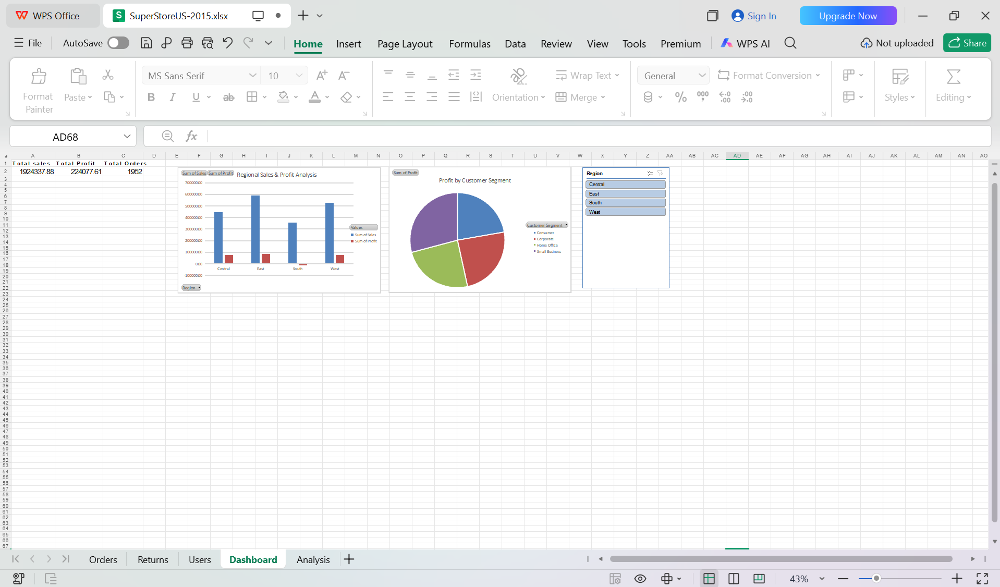

# Retail Sales Analysis — SuperStore US (Jan–Jun 2015)

## Project Overview
Analysed 1,952 retail transactions from the SuperStore US dataset using SQL and Excel to identify sales trends, regional performance, and customer insights.

## Dashboard

## Tools Used
* PostgreSQL — data querying and analysis
* Excel — interactive dashboard with pivot tables, charts and slicer

## Business Questions Answered
1. Which region generates the most sales and profit?
2. Which product category has the highest profit margin?
3. Who are the top 10 customers by total sales?
4. Which month has the highest sales?
5. What is the profit by customer segment?
6. Why is the South region making a loss?

## Key Insights
* East has the highest sales ($592,171), but South runs at a loss (-$14,424 profit)
* South's loss comes from Technology (-$13,450), mainly Telephones and Communication (-$12,905)
* Office Supplies has the best profit margin (16.24%), followed by Technology (10.57%) and Furniture (8.97%). Overall margin is 11.64%
* Top customer Kristine Connolly generated $50,475 in sales
* Small Business is the most profitable segment ($65,305)
* April has the highest sales ($389,832). Data covers Jan–Jun 2015 only

## Recommendations
* Review pricing and discounts on Telephones and Communication in the South region
* Focus marketing on Small Business, the most profitable segment
* Push Office Supplies, which has the highest margin (16.24%)

## Files
* `superstore_analysis.sql` — all SQL queries with comments
* `SuperStoreUS-2015.xlsx` — Excel dashboard with charts, KPIs and interactive slicer
* `dashboard.png` — dashboard screenshot

## Dataset
SuperStore US 2015 — 1,952 rows. Source: (yahan dataset ka link ya source likho)
